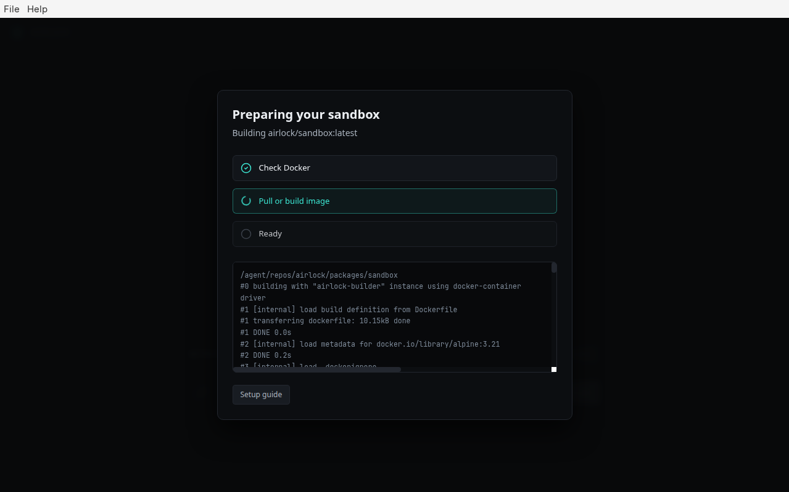
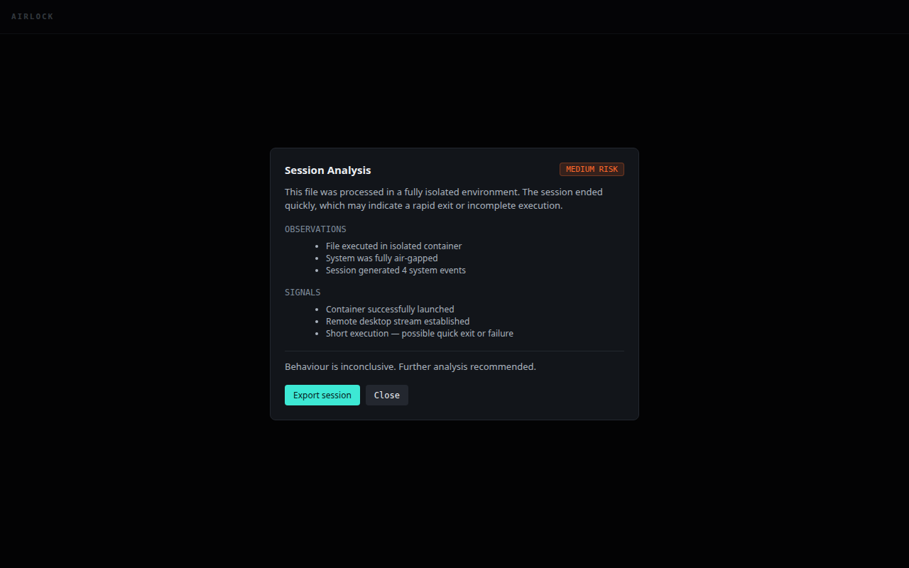
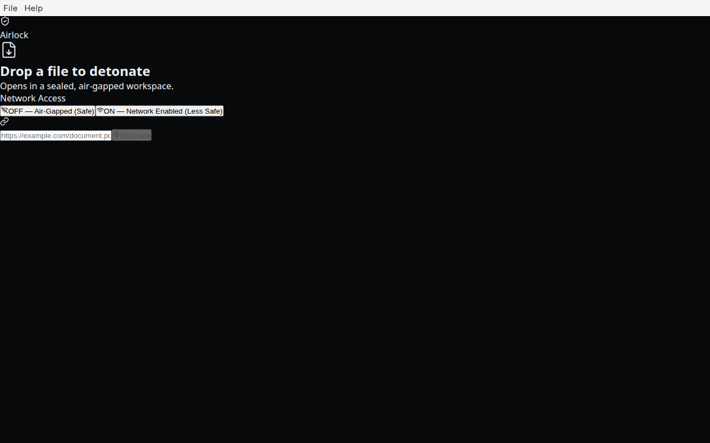
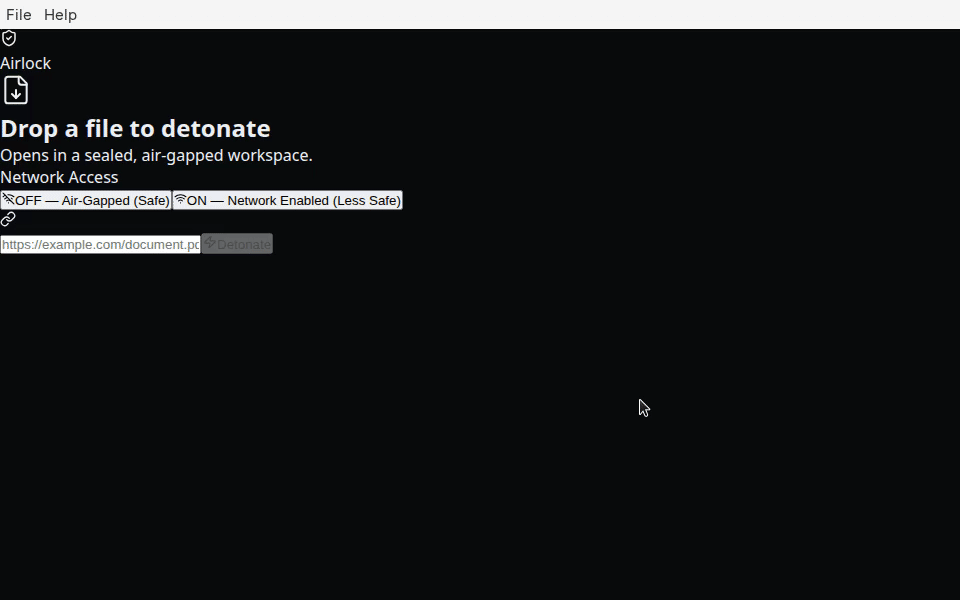

# Airlock 🔒

Local-first, disposable sandboxed workspace. Electron + Docker + KasmVNC.

Drop a file in. It opens in an isolated container. The container dies when you're done. Nothing persists. Nothing escapes.

**End users:** see **[Getting started](docs/getting-started.md)** for install steps, first-run sandbox setup, and troubleshooting.

Design inspired by OpenClaw (Electron shell patterns; no OpenClaw source remains in this repository).

**Current version:** `0.4.1`

---

## Demo / screenshots

| | |
|---|---|
| First-run sandbox setup |  |
| Session ended (analyze & export) |  |
| Ready to detonate |  |

**Short demo (first-run → idle → post-session):**



> **TODO:** Add a screenshot of an **active session** with the KasmVNC desktop visible, captured on a real GPU desktop (headless CI VMs cannot render the VNC canvas).

Captured on a clean Linux VM with Docker Engine, Xvfb, and builds from `main` (see [clean-machine test](docs/CLEAN_MACHINE_TEST.md)).

---

## What It Does

You drag a file — a PDF, a `.docx`, an HTML attachment, a suspicious installer — onto Airlock. It spins up an ephemeral Docker container with a minimal headless desktop (KasmVNC), opens the file inside it using a sandboxed viewer (**Chromium**, **Evince**, **LibreOffice** for Office formats), runs **offline static triage** (ExifTool, PDF/Office probes, vendored YARA — no ClamAV), and streams the visual output plus a **nutrition-label panel** back to your screen via a WebSocket VNC feed.

When you close the session, the container is forcibly killed and removed. No trace. No persistence. No network by default.

You can also open URLs in a sandboxed Chromium instance when network access is explicitly enabled for that session.

After a session ends, Airlock can run a lightweight deterministic analysis over captured session artefacts (logs, metadata) and surface a risk summary in the UI.

---

## Architecture

```
┌────────────────────────────────────────────────┐
│                  Electron Shell                  │
│         packages/ui  (React + KasmVNC viewer)    │
│                                                  │
│  [ Drag & Drop Zone ]   [ VNC Canvas Stream ]    │
└────────────────────┬────────────────────────────┘
                     │ IPC
┌────────────────────▼────────────────────────────┐
│              Core Orchestrator                   │
│         packages/core  (Node.js + dockerode)     │
│                                                  │
│  [ Session lifecycle ]  [ Artefact capture ]     │
│  [ Drop validation ]    [ GC / crash traps ]     │
└────────────────────┬────────────────────────────┘
                     │ Docker socket
┌────────────────────▼────────────────────────────┐
│             Sandbox Environment                  │
│      packages/sandbox  (Docker + KasmVNC)        │
│                                                  │
│  [ Headless X11 ]  [ KasmVNC stream :6901 ]      │
│  [ Chromium / Evince / LibreOffice ]             │
│  [ Air-gapped by default ] [ Read-only mounts ]  │
└─────────────────────────────────────────────────┘
```

---

## Monorepo Structure

```
airlock/
├── packages/
│   ├── ui/                 # Electron + React frontend
│   │   └── src/
│   │       ├── main/       # Electron main process, IPC, readiness checks
│   │       ├── preload/    # contextBridge API
│   │       └── renderer/   # React UI, drag-drop, VNC viewer
│   │
│   ├── core/               # Node.js orchestrator
│   │   └── src/
│   │       ├── docker/     # ContainerManager, seccomp, network, image probe
│   │       ├── session/    # execute/destroy session, artefacts, logging
│   │       ├── analysis/   # Lightweight post-session analysis
│   │       └── validation/ # Drop validation + MIME sniff
│   │
│   └── sandbox/            # Docker image definition
│       ├── Dockerfile
│       └── entrypoint.sh
│
├── scripts/                # Smoke tests and core resolution helpers
├── package.json
└── README.md
```

---

## Core Principles

### 1. Ephemeral by Default
Every container is created fresh and destroyed on session end. No volumes persist between sessions. No state is written to the host outside of explicitly opted-in export paths.

### 2. Air-Gapped by Default
File sessions attach to an internal Docker bridge (`airlock-isolated`) with no external egress. Network access is a deliberate, per-session opt-in.

### 3. Violent Garbage Collection
If the Electron main process crashes, exits, or is force-quit, crash traps issue `docker kill` + `docker rm` against all containers spawned in that session.

### 4. Read-Only File Mounts
Dropped files are mounted into the container as `:ro`. The sandbox can render the file but cannot modify it or write derivatives back to the host without an explicit export action.

### 5. Minimal Attack Surface
Capabilities are dropped (`--cap-drop ALL`). A custom seccomp profile is applied. No privilege escalation. No host PID or network namespace sharing.

---

## Security architecture and threat boundaries

Airlock separates **untrusted content** (opened files/URLs) from your **host desktop** using ephemeral Linux containers. Understanding where the boundary sits helps set expectations for regulated and high-risk workflows.

### Where containers actually run

| Host OS | What runs your sandbox |
|---------|-------------------------|
| **Linux (native)** | Containers share the **host kernel** with Docker/PodPodman unless you opt into an alternate runtime (see gVisor below). |
| **macOS / Windows** | Docker Desktop runs Linux containers inside a **Linux VM** (hypervisor + container). That is an additional boundary versus native Linux, but the VM kernel is still shared by all containers in that VM. |
| **Optional gVisor (`runsc`)** | When `AIRLOCK_RUNTIME=runsc` is set **and** `runsc` is registered with Docker (`docker info` lists it), Airlock passes `--runtime=runsc` for stronger syscall mediation. **Off by default**; requires local gVisor install. |

### Desktop shell (Electron)

- Renderer: **`contextIsolation: true`**, **`nodeIntegration: false`**, **`sandbox: true`**, strict **CSP** (see `packages/ui/src/renderer/index.html`).
- KasmVNC is embedded via an **iframe** limited to **loopback HTTP** VNC URLs; other origins are rejected in UI and `window.open` is denied except external hand-off via the OS browser.
- Strips restrictive `X-Frame-Options` / CSP headers **only** for `http://127.0.0.1:*` so the local VNC client can load — not for arbitrary remote sites.

### VNC / WebSocket exposure

Published VNC binds to **`127.0.0.1`** on the host. Other machines cannot reach the stream unless the host firewall or Docker publishing policy is misconfigured. The Electron UI should only embed verified loopback URLs.

### What Airlock does **not** protect against

- **Malware on the host OS** outside Docker (keyloggers, compromised Electron preload if local build is tampered, etc.).
- **Kernel bugs** on native Linux (without gVisor/Kata); container escape classes apply as with any OCI runtime.
- **User-enabled network egress** for URL sessions — you explicitly opt in to bridge networking.
- **Deterministic “safe” verdicts** — static checks (v0.5+) report indicators; **isolation and destroy** remain the primary control.
- **Signed desktop binaries** — installers are unsigned today (SmartScreen/Gatekeeper friction).

See also [`docs/security-model.md`](docs/security-model.md) for user-facing isolation copy.

---

## Security Hardening Profile

| Control | Value |
|---|---|
| Network | Internal bridge (`airlock-isolated`) for file sessions; bridge egress only when opted in |
| Capabilities | All dropped (`--cap-drop ALL`) |
| Seccomp | Custom profile (Moby default basis, Airlock-hardened) |
| Root filesystem | **Read-only** rootfs; bounded **tmpfs** for `/tmp`, caches, and viewer config |
| Resources | **2 GiB** RAM (swap capped to match), **2 CPUs**, **256 PIDs** (defaults) |
| AppArmor | Planned — not fully enforced yet |
| Mount | `:ro` read-only for input files |
| Privilege | No new privileges (`--security-opt no-new-privileges`) |
| PID namespace | Host isolated |
| User | Non-root inside container |
| Optional runtime | `AIRLOCK_RUNTIME=runsc` when gVisor is registered |
| Drop validation | Magic-byte MIME sniff; extension spoofing rejected before session start |

---

## Tech Stack

| Layer | Technology |
|---|---|
| Desktop Shell | Electron |
| UI Framework | React + TypeScript + Tailwind |
| Orchestrator | Node.js + dockerode |
| Container Runtime | Docker-compatible API (Docker, Podman, OrbStack, Colima, Rancher Desktop) |
| Remote Desktop | KasmVNC |
| Display Server | Xvfb (headless X11) |
| Package Manager | pnpm workspaces |
| Build | TypeScript + Vite |

---

## Prerequisites

- A **Docker-compatible container engine** (Docker Desktop, Podman, OrbStack, Colima, or Rancher Desktop) — running before you start a session. Airlock **refuses** engines that cannot apply its hardened container spec (cap-drop ALL, custom seccomp, read-only root, cgroup limits).
- **Node.js** >= 20
- **pnpm** >= 9

---

## Open in Airlock (OS integration)

Packaged builds register **Open in Airlock** handlers for common document types and the `airlock://` URL scheme.

- **Windows / Linux:** Right-click a supported file → **Open with** → Airlock (exact menu text varies by OS).
- **macOS:** Open the file with Airlock from Finder’s **Open With** menu, or use `airlock:///path/to/file` / `airlock://open?path=/path/to/file`.
- **URLs:** `airlock://open?url=https://example.com/report.pdf` (network sessions require enabling network in the app).
- **Single instance:** Opening a second file or `airlock://` link focuses the running app and queues detonation in the existing window.

---

## First-Run Setup

Airlock auto-detects a local engine socket (Docker Desktop, `~/.colima`, OrbStack, Rancher Desktop, Podman, or `DOCKER_HOST`). The sandbox image is provisioned automatically when possible:

1. **GHCR pull** — `ghcr.io/lukeholmes/airlock-sandbox:<version>` (after first release tag is published)
2. **Bundled build fallback** — packaged apps include the sandbox Dockerfile in `resources/sandbox/`
3. **Manual dev build** — `pnpm sandbox:build` for local development

On first launch, the app **auto-runs setup** when the image is missing, with a progress overlay (pull GHCR, then bundled build fallback). Use **Retry** if Docker was not ready.

### Developers

```bash
pnpm install
pnpm build
pnpm sandbox:build    # or rely on ENSURE_SANDBOX_IMAGE / GHCR pull
pnpm dev              # HMR dev workflow
```

---

## Common Commands

| Command | Purpose |
|---|---|
| `pnpm dev` | Dev workflow — Vite HMR, `tsc` watch, electronmon |
| `pnpm build` | Build core + UI |
| `pnpm package` | Build desktop installer (DMG / NSIS / AppImage) via electron-builder |
| `pnpm sandbox:build` | Build `airlock/sandbox:latest` via Docker BuildKit/buildx |
| `pnpm airlock:test` | End-to-end smoke test (create → VNC → destroy, no orphans) |
| `pnpm sandbox:smoke` | Smoke-test the sandbox image |
| `pnpm core:smoke` | Integration smoke test via ContainerManager (requires sandbox image) |
| `pnpm test` | Core unit tests (`validateDrop`, etc.) |
| `pnpm typecheck` | TypeScript check across packages |
| `pnpm lint` | ESLint |

---

## Usage

### File sessions (default)
1. Drop a file onto the window (or use **File → Open**).
2. Airlock validates the file (size, MIME sniff, extension consistency) before starting a container.
3. The file is mounted read-only and opened in Evince, Chromium, or another sandboxed viewer.
4. Click **Destroy workspace** when finished.

### URL sessions (network required)
1. Enable the **Network** toggle in the UI.
2. Enter an `http://` or `https://` URL and submit.
3. The container runs with bridge network access so Chromium can reach the URL.

### Post-session analysis
After destroying a workspace, click **Analyze session** to run the lightweight deterministic analysis engine over captured session logs and metadata.

---

## Status (v0.3.1+)

> Core sandbox loop works end-to-end. Packaging, zero-config infrastructure and installer icons have landed. No tagged release yet; see [docs/MVP_PLAN.md](docs/MVP_PLAN.md) for the path to a v0.4 MVP release.

**Working today**

- [x] Monorepo scaffold (`core`, `ui`, `sandbox`)
- [x] dockerode container lifecycle + seccomp hardening
- [x] Sandbox Dockerfile (KasmVNC + headless desktop)
- [x] Electron drag-and-drop + KasmVNC renderer
- [x] Garbage collection & crash trap hooks
- [x] Air-gapped network mode (default) + per-session network toggle
- [x] URL session support (network opt-in)
- [x] Session artefact capture + lightweight analysis (in-memory)
- [x] Desktop packaging (`pnpm package`) + bundled sandbox build context
- [x] Fast dev workflow (`pnpm dev`)
- [x] First-run readiness checks (Docker + sandbox image)
- [x] Drop validation with MIME sniff
- [x] Sandbox image resolution (`ensureSandboxImageReady` — pull / build)
- [x] GHCR publish workflow (on `v*` tags)

**In progress / v0.4**

- [ ] Auto-setup UX on first launch (progress UI)
- [x] App icon for installers
- [x] End-user setup docs (`docs/`)
- [x] Opt-in session export (JSON to disk)

**Still open**

- [ ] AppArmor enforcement
- [ ] Code signing / notarization
- [ ] MIME sniffing via dedicated library

---

## Reference Architecture Sources

Airlock's design draws from four open-source reference implementations:

- **KasmVNC** — Containerised headless X11 + VNC stream pipeline
- **Dockerode** — Node.js Docker daemon bindings and container lifecycle patterns
- **Moby (Docker)** — Default container seccomp profile (v27.4.0) as the upstream syscall baseline
- **Dangerzone** — Inspiration for disposable, network-isolated viewing workflows (not a code or seccomp source)

---

## Licence

Apache-2.0 (see [LICENSE](LICENSE) and [THIRD_PARTY_LICENSES.md](THIRD_PARTY_LICENSES.md)).
